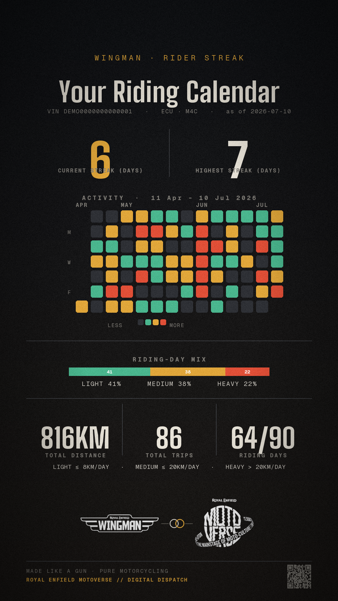

# streak-calendar

A self-contained **"Rider Streak" calendar card** generator — a GitHub-style
riding-activity calendar rendered as a 1080×1920 share card. Extracted from the
Wingman persona project into a standalone, pip-installable package.



## What it does

From a Wingman telemetry export (CSV/XLSX) it produces, per rider, a card with:

- a **day-by-day activity calendar** over the last 90 days, each day coloured by
  how far they rode — `NONE` / `LIGHT` / `MEDIUM` / `HEAVY`
- **current** and **highest** streak (consecutive ride-days)
- the **riding-day mix** and totals (distance, trips, riding days)

## Structure

```
streak-calendar/
├── streak_calendar/          # the package
│   ├── config.py             # paths, window, bucket thresholds (env-overridable)
│   ├── telemetry.py          # raw export  -> clean per-trip table
│   ├── layer.py              # per-trip table -> daily buckets / streaks / summary  (pure, no PIL)
│   ├── theme.py              # shared render toolkit: canvas, fonts, text, QR, co-brand
│   ├── card.py               # summary -> 1080x1920 PNG
│   ├── cli.py                # file -> one card per rider
│   ├── __main__.py           # `python -m streak_calendar`
│   └── assets/               # vendored fonts + brand logos (ship with the package)
├── examples/demo.py          # render a card from synthetic data (no telemetry needed)
├── tests/test_layer.py       # unit tests for the streak logic
├── pyproject.toml
└── requirements.txt
```

Three clean layers, each usable on its own: **telemetry → layer → card**.

## Install

```bash
pip install -r requirements.txt
# or, as an editable package (adds the `streak-calendar` command):
pip install -e .
```

Python ≥ 3.10. The fonts and logos are bundled, so a fresh clone renders
anywhere with no extra setup.

## Usage

### Quick look (no data needed)

```bash
python examples/demo.py          # writes streak_demo.png from synthetic data
```

### Command line (real telemetry)

```bash
python -m streak_calendar <path.csv|xlsx> [YYYY-MM-DD]
```

- One `streak_<VIN>.png` is written per rider into `./streak_cards/`
  (override with the `STREAK_OUT` env var).
- The optional date is "today" — the calendar window is the 90 days ending on
  it. If omitted, the latest timestamp in the file is used.

### Live OBD API (no file needed)

Instead of a file, a rider's history can be pulled straight from the Wingman
`getObdHistoryByVin` GraphQL endpoint (returns ~90 days by default):

```bash
set RE_API_TOKEN=<bearer-jwt>        # short-lived token (or pass --token)
python -m streak_calendar --vin ME3P7B6FLN1000035 [--today YYYY-MM-DD]
```

- `--vin` is repeatable (one card per VIN); `--token` / `RE_API_TOKEN` carries the
  bearer JWT; `--base-url` / `RE_API_URL` overrides the endpoint (default: SIT).
- Only the fields the model needs are requested — `vehiclenumber, ts,
  vehicleSpeed, obdDistance, ecu_type` (see `OBD_FIELDS` in
  [`api.py`](streak_calendar/api.py)); `ts` (epoch seconds) is converted to IST.
- Uses the standard library only — **no extra dependency** for the HTTP call.

As a library:

```python
from streak_calendar import read_obd_api, rider_streak_summary, card_from_summary, identity

df = read_obd_api("ME3P7B6FLN1000035", token="<jwt>")   # same frame shape as read_any
for _, t in df.groupby("IMEI"):
    summary = rider_streak_summary(t, today=df["ts"].max())
    card_from_summary(summary, identity(t["VIN"].iloc[0], t["ECU_TYPE"].iloc[0]),
                      out=f"streak_{t['VIN'].iloc[0]}.png")
```

### As a library

```python
from streak_calendar import read_any, rider_streak_summary, card_from_summary, identity

df = read_any("ride_export.xlsx")
for _, t in df.groupby("IMEI"):
    summary = rider_streak_summary(t, today="2026-07-10")   # pure dict, no rendering
    card_from_summary(
        summary,
        identity(t["VIN"].iloc[0], t["ECU_TYPE"].iloc[0]),
        out=f"streak_{t['VIN'].iloc[0]}.png",
        accent=(224, 166, 58),                              # optional brand accent
    )
```

`rider_streak_summary` does the whole calculation with no PIL dependency, so you
can use the streak numbers without rendering anything.

## Input schema

The telemetry reader expects these columns (a standard Wingman export):

`IST_time_stamp`, `IMEI`, `VIN`, `ECU_TYPE`, `Speed`, `Odometer`,
`Delta_Distance`, `Vehicle_Speed_Samples_separated`, `Engine_Speed_Samples`,
`Throttle_Opening`, `Gear_Position`, `Altitude`.

Rows are segmented into trips by **time gaps** (a gap > 20 min starts a new
trip); only sessions that actually moved count.

## Tuning

Day-level distance buckets are data-derived tertiles and live in
[`config.py`](streak_calendar/config.py):

| bucket | daily distance |
|--------|----------------|
| `NONE`   | 0 km |
| `LIGHT`  | ≤ 8 km |
| `MEDIUM` | ≤ 20 km |
| `HEAVY`  | > 20 km |

Recalibrate `TH_LIGHT_MAX` / `TH_MEDIUM_MAX` for your own fleet. The window
length is `WINDOW_DAYS` (default 90).

## Tests

```bash
pytest
```

The tests cover the streak logic (bucket thresholds, longest-run detection, and
the one-day-gap-tolerant "current" streak) and need no telemetry file.

## License

MIT. Bundled fonts (Big Shoulders, Geist Mono, Italiana) are under the SIL Open
Font License — see `streak_calendar/assets/fonts/*-OFL.txt`.
